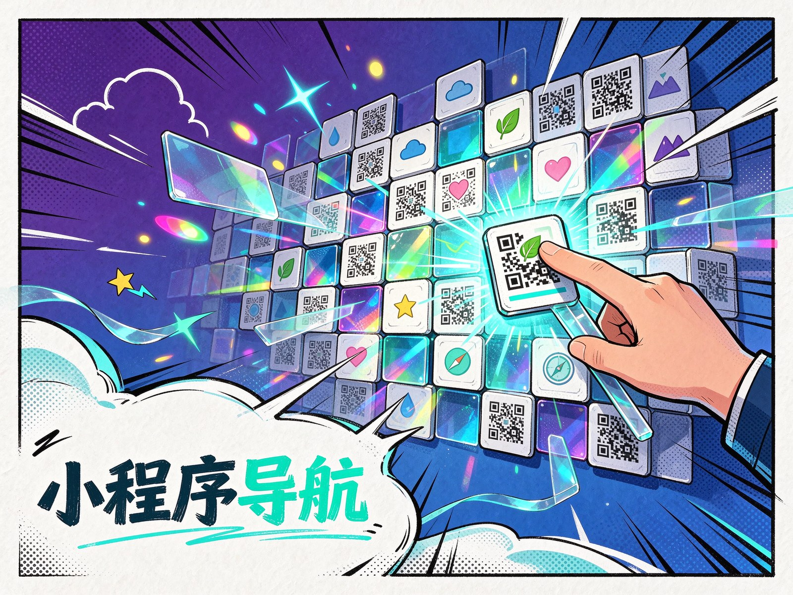

<p align="center"></p>

# 📱 KnowledgeLinkerX

**微信小程序 & 公众号导航中心，一页聚合你的所有小程序入口。**

[](https://aiyangtongxue.github.io/KnowledgeLinkerX)

---

## 📌 项目简介

KnowledgeLinkerX 是一个精美的微信小程序与公众号导航页面，将多个小程序和公众号的图标与二维码集中展示，用户扫码即可快速访问。页面采用卡片式布局，分类清晰，交互流畅，适合个人或团队作为小程序入口导航使用。

---

## ✨ 核心特性

- 🗂️ **分类展示** — 微信小程序、QQ 小程序、公众号三大分区，清晰明了
- 🎴 **卡片式布局** — 每个小程序独立卡片，包含图标、名称、二维码
- ✨ **悬停动效** — 鼠标悬停卡片上浮 + 阴影加深，交互体验流畅
- 🎨 **渐变设计** — 头部渐变背景 + 页面柔和渐变底色，视觉层次丰富
- 📱 **响应式适配** — Flexbox 弹性布局，自动适配不同屏幕宽度
- 🖼️ **图标 + 二维码** — 圆形图标 + 方形二维码，扫码即用

---

## 🛠️ 技术栈

| 技术 | 用途 |
|------|------|
| HTML5 | 语义化页面结构 |
| CSS3 | Flexbox 布局、渐变背景、过渡动画、圆角阴影 |
| 静态资源 | 图标与二维码图片本地存储 |

---

## 🚀 快速开始

### 前置条件

- 现代浏览器（Chrome / Firefox / Edge / Safari）

### 安装步骤

```bash
git clone https://github.com/aiyangtongxue/KnowledgeLinkerX.git
cd KnowledgeLinkerX
```

### 运行

直接在浏览器中打开 `index.html` 即可使用。

### 自定义导航

1. 将你的小程序图标和二维码图片放入 `images/` 目录
2. 在 `index.html` 中添加新的 `.app-item` 区块：

```html
<div class="app-item">
    
    <h2>小程序名称</h2>
    
</div>
```

3. 使用 `<hr class="separator">` 添加分类分隔线

---

## 📂 项目结构

```
KnowledgeLinkerX/
├── index.html                          # 主页面
├── styles.css                          # 样式文件
├── images/                             # 图标与二维码资源
│   ├── aiyangchongni_icon.png          # 艾阳宠你啊 图标
│   ├── aiyangchongni_qrcode.jpg        # 艾阳宠你啊 二维码
│   ├── aiyangxuexijilu_icon.jpeg       # 艾阳学习记录 图标
│   ├── aiyangxuexijilu_qrcode.jpg      # 艾阳学习记录 二维码
│   ├── bijibenxuexijilu_icon.png       # 笔记本学习记录 图标
│   ├── bijibenxuexijilu_qrcode.jpg     # 笔记本学习记录 二维码
│   ├── zhishixiaopu_icon.jpeg          # 知识小铺 图标
│   ├── zhishixiaopu_qrcode.jpg         # 知识小铺 二维码
│   ├── zhishijiayouzhan_icon.png       # 知识加油站 图标
│   ├── zhishijiayouzhan_qrcode.jpg     # 知识加油站 二维码
│   ├── quShuiYin_icon.png              # 去水印 图标
│   ├── quShuiYin_qrcode.jpg            # 去水印 二维码
│   ├── aikejiyunwangluo_icon.jpg       # 艾科技云网络 图标
│   └── aikejiyunwangluo_qrcode.jpg     # 艾科技云网络 二维码
├── CNAME                               # GitHub Pages 自定义域名
└── README.md                           # 项目说明
```

---

## 🤝 贡献与许可证

欢迎提交 PR 或 [报告问题](https://github.com/aiyangtongxue/KnowledgeLinkerX/issues)！

本项目采用 MIT 开源协议，您可以自由使用、修改和分发。

---

*📱 扫码即达，一页聚合你的小程序世界*
